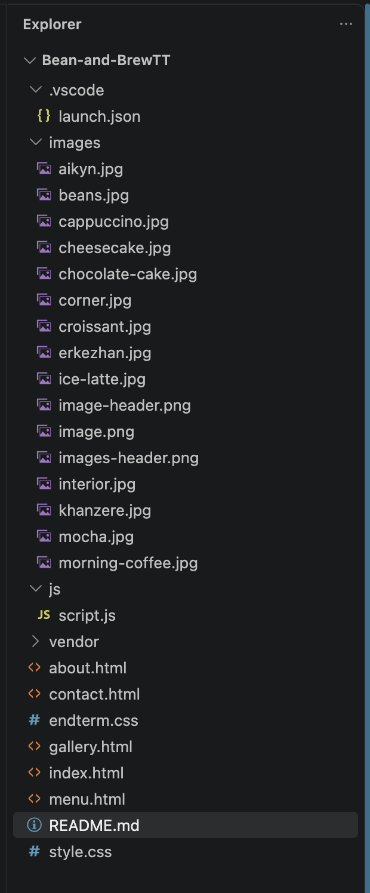

# Bean & Brew Coffee Shop

## Project Topic

Bean & Brew is a responsive multi-page coffee shop website.

## Group Members

- Yerkezhan Vassenzhan
- Suleimen Khanzere
- Aikyn Sabit
## LINK OF THE PAGE: https://khanziik.github.io/webmidcoffee/
## Description

Bean & Brew is a modern coffee shop website where users can view the coffee menu, learn about the coffee shop, see the gallery and contact the coffee shop.

## Pages

- Home
- About
- Menu
- Gallery
- Contact

## Features

- Responsive navigation
- Coffee menu with prices
- Responsive image gallery
- Contact form
- Responsive design for desktop, tablet and mobile
- CSS Flexbox
- CSS Grid
- Bootstrap Grid
- Hover and focus effects
- Responsive media queries
- Google Fonts
- Lazy-loaded images

## Technologies

- HTML5
- CSS3
- Flexbox
- CSS Grid
- Bootstrap 5.3.3
- JavaScript (DOM, native dialogs and localStorage)
- jQuery 3.7.1

## Individual Contribution (Midterm + Endterm)

### Yerkezhan Vassenzhan
- Created the website structure
- Developed the HTML pages
- Created responsive CSS
- Menu manager with add, edit, delete, and localStorage

### Suleimen Khanzere
- Implemented Flexbox and CSS Grid
- Added Bootstrap Grid
- Gallery lightbox, photo navigation, and fade effects
- Responsive styling and README updates

### Aikyn Sabit
- Created the navigation and footer
- Created the coffee menu and contact form
- Added photos
- Form validation and the password strength indicator
- Menu search and category filters

## Project Structure

## Endterm features

- **Contact** validates name, email and message as you type. The separate registration form checks required fields, email format, password strength and confirmation. Both forms give local feedback. Passwords stay in the form and are never sent or stored.
- **Menu** combines live text search with Coffee and Desserts filters on the original price list and cards.
- **Menu manager** starts with the original drinks in each listed size and all three desserts. Add, edit or delete items in a separate table. Records persist in localStorage on the current browser and origin. If storage is unavailable, changes last for the current page session.
- **Gallery** opens all nine original photos in a lightbox with smooth transitions. Use the arrows to browse and Escape, Close or the surrounding background to dismiss it.
